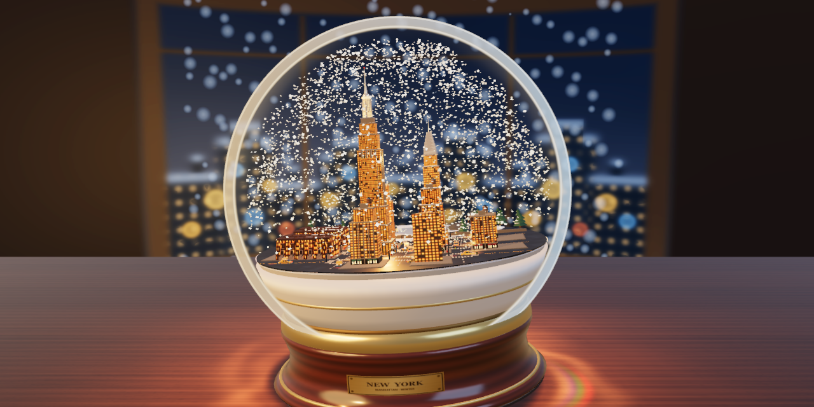
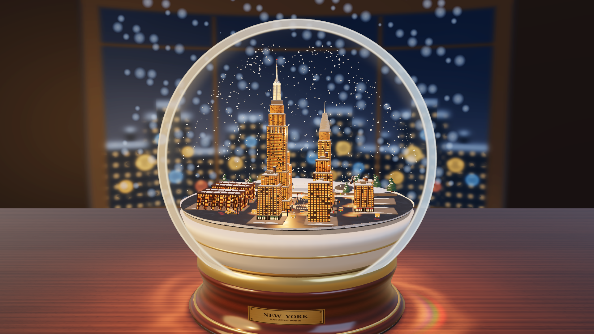
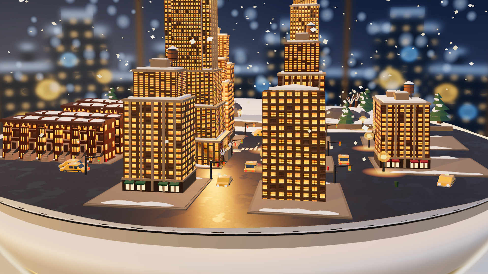
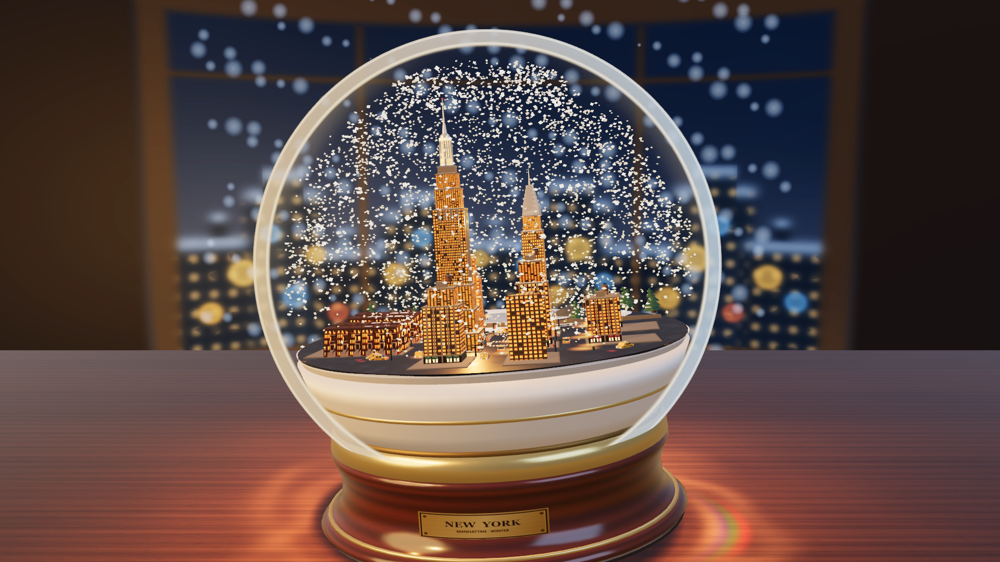

# New York at night in a snow globe

A miniature New York at night inside a glass snow globe on a walnut desk, built in Three.js (`three/webgpu` and TSL). Nearly every window in the Empire State Building, the Chrysler Building, the Flatiron wedge, the midtown towers and the West Side brownstones glows warm amber from within; twelve yellow cabs drive the avenues with their headlights and taillights on, street lamps cast warm pools on the wet asphalt, and a soft pool of golden light and refractive caustics spills out of the glass onto the wood grain around the base. Behind the desk, an out-of-focus night window looks out over distant Manhattan bokeh and falling snow. Grab the glass to tilt, lift and shake it into a full-volume blizzard that takes six to eight seconds to settle back over the city. Everything on screen and everything you hear is generated in code at load time: the buildings, the facades, the trees, the taxis, the walnut and brass base, the glass optics, the snow and the sound. The repository ships no 3D models, texture images, HDRIs or audio files.



**Watch it: https://starknightt.github.io/nyc-snow-globe/**

**Code: https://github.com/StarKnightt/nyc-snow-globe**

It runs in browsers with WebGPU (Chrome and Edge look best) and falls back automatically to WebGL 2 where WebGPU is unavailable. On load it opens mid-shake with the city glowing and snow swirling through the dome.

## Running it locally

```bash
git clone https://github.com/StarKnightt/nyc-snow-globe.git
cd nyc-snow-globe
pnpm install
pnpm dev          # http://127.0.0.1:5192/
pnpm typecheck    # tsc --noEmit
pnpm build        # type-check + production build into dist/
pnpm preview      # serve dist/ on http://127.0.0.1:5193/
pnpm capture      # capture 9 verification shots + og.png via Playwright
```

CI builds with Node.js 22 and `pnpm` (`package.json` pins `pnpm@10.18.3`). The only runtime dependency is `three` (`^0.186.1`). The build uses a relative base (`./`), so `dist/` works from any sub-path; every push to `main` builds and deploys it to GitHub Pages through `.github/workflows/deploy.yml`.



## Controls

| Input | Action |
|---|---|
| Drag the glass globe | Grab, tilt, lift and shake the snow globe to stir up a full-volume blizzard |
| `Space` | Trigger a vigorous multi-impulse shake |
| Drag the background / desk | Orbit the camera around the snow globe |
| Scroll wheel | Zoom in from the full desk view down to Manhattan street level |

| URL option | Effect |
|---|---|
| `?renderer=webgl` | Force the WebGL 2 fallback path instead of WebGPU |
| `?capture=1` | Deterministic capture mode (freezes auto-orbit, skips the startup loader and exposes `window.__globe`) |

## What is in it

- About 2,600 lines of TypeScript across 6 files in `src/`.
- **The miniature city.** The Empire State Building with stepped Indiana limestone setbacks, 16 fluted stainless-steel ribs on the mooring mast, a glowing 102nd-floor observation gallery and a red aviation beacon; the Chrysler Building with its six-tier Nirosta steel sunburst crown, glowing triangular dormers and corner eagle gargoyles; the triangular Flatiron building; midtown pre-war and curtainwall towers with ground-floor bronze storefronts and awnings; four rows of West Side brownstones with front stoops, wrought-iron railings, bracketed cornices and snowy rear courtyards; and a northern slice of Central Park with a stone perimeter wall, a frozen pond, Gapstow Bridge, Manhattan schist outcrops and snow-laden pines.
- **Night illumination from within.** Roughly 88% of building windows glow in warm golden-yellow, amber and honey-cream tones via procedural emissive maps, paired with two warm `PointLight` emitters inside the globe so the snow globe itself is the brightest light source in the room.
- **Street life and traffic.** Twelve yellow sedan taxis drive four non-overlapping avenue and crosstown loops with warm headlights, street-level headlight beams, glowing rooftop medallion lights and red taillights, passing cast-iron street lamps with warm light pools, cantilevered traffic signals, fire hydrants, wire-mesh waste bins and winter pedestrians in overcoats and scarves.
- **The globe, the desk and the night window.** A turned American walnut base on a dark-umber felt pad, a brushed champagne brass collar and gasket ring, and an engraved `NEW YORK · MANHATTAN · WINTER` brass plaque. The globe sits on a straight-grain walnut tabletop where warm golden light and organic refractive caustics spill out around the base. Behind the desk, a curved night window (`R = 10.5`) frames an out-of-focus New York skyline, warm amber and cool sapphire bokeh discs, and 240 soft snowflakes drifting down outside.
- **4,500 3D snow crystals.** Tumbling octahedron flakes that catch the warm city light and glint as they swirl through the full water volume, take six to eight seconds to settle back onto rooftops and trees after a shake, and keep a light, steady snowfall (675 active drifters) in idle state.
- **Synthesised sound.** Web Audio modal glass chime when you grab the dome, bandpass-filtered liquid slosh and Minnaert bubble pops while shaking, and a damped wooden thud when the base settles back onto the walnut desk. No audio files.



## How it works

**Procedural everything.** All textures—straight-grain quarter-sawn walnut planks, turned walnut base grain, the engraved brass plaque, wet winter asphalt, four architectural building facade styles with matching roughness and night emissive maps, and the out-of-focus night NYC window vista—are painted onto 2D canvases at boot (`src/textures.ts`). Every building, stoop, bridge, tree and taxi is built in code (`src/manhattan.ts`, `src/taxis.ts`).

**Water-lens refraction and TSL glass optics.** At load time, `applySphericalWaterLensToHierarchy` in `src/main.ts` radially magnifies and barrel-curves the city geometry inside the water sphere ($1.04\times$ at the center up to $1.24\times$ near the inner wall). The outer dome uses a custom TSL `MeshBasicNodeMaterial` (`glassOpticsNode` in `src/globe.ts`) that keeps the central 83% of the sphere completely clear so the city is never hazed over, while drawing a double-walled borosilicate rim at the silhouette ($r_{\text{disk}} \in [0.938, 1.000]$) and grazing-angle crescent highlights ($\text{pow}(1 - \mathbf{N}\cdot\mathbf{V}, 4.2)$) from the warm table lamp on the left and the cool night window on the right.

**Desk light spill and caustics.** Instead of a floating overlay plane, the walnut desk's `MeshStandardNodeMaterial` runs a TSL `colorNode` (`deskSurfaceNode` in `src/globe.ts`) in 3D desk coordinates `(positionLocal.x, positionLocal.z)`. It darkens the outer room into a cozy warm espresso (never `#000000` black), places tight contact ambient occlusion under the felt pad ($r < 1.33$), spills a warm golden pool of light around the base ($r \in [1.32, 4.2]$), and modulates the walnut wood fibers directly with organic golden caustic cusps and a dispersive warm-prismatic cardioid caustic on the right-front of the base.

**Full-volume turbulent snow.** `src/snowSystem.ts` drives 4,500 instanced 3D octahedron crystals inside the spherical water cavity. Shaking the globe injects angular momentum and 3D curl-like eddy velocities so flakes fill the entire dome from street canyons up to the apex without central clumping. Viscous vortex decay ($\tau \approx 3.33\text{ s}$) and per-flake terminal velocities (`0.16–0.27` units/s) produce a slow, six-to-eight-second settling phase that gradually restores rooftop snow thickness. Each crystal tumbles on two axes and updates its instance color (`flakeMesh.instanceColor`) when its facets glint in the city light.



## Performance

- Measured in Chrome on Windows (RTX 4060, `1920×1080`, WebGPU): **~5.0–5.2 ms median frame time** (`p95: 5.5–6.4 ms`, locked 60 fps on a 60 Hz display / ~192–200 fps uncapped), with **2 render pass draw calls** and ~150,483 triangles.
- After applying spherical water-lens magnification at boot, `batchManhattanStaticMeshes` in `src/main.ts` merges ~1,100 static city meshes by material and shadow flags into unified `BufferGeometry` batches, and merges all ~110 accumulatable rooftop snow caps into a single vertex-modulated mesh.
- All 12 taxis share pre-merged per-material sub-geometries, and the snow system writes 4×4 matrices and RGB glints directly into typed `InstancedBufferAttribute` arrays.

## How it was built

It was built in Cursor over six builder and critic rounds. After each round, a headless Playwright harness (`scripts/capture.mjs`) captured nine `1920×1080` screenshots (six fixed camera angles around and inside the globe, plus three deterministic shake frames: impulse, peak blizzard and settling), and a separate critic agent—which saw only the screenshots—compared them against real photographs of snow globes and miniature cities:

- **Round 1 (initial build & 16 fixes):** Built the procedural Manhattan snow globe and fixed 16 foundational issues across glass rim thickness, wood grain, Empire State and Chrysler crown geometry, brownstone stoops, Central Park terrain and snow density.
- **Round 2 (10 optical & street-level fixes):** Bounded all 3D octahedron snow crystals strictly inside the spherical water wall, balanced wet asphalt roughness and raised granite curbs, added double-walled glass meniscus rings and a snow-dressed limestone plinth, counter-rotated the top water boundary against tilt, replaced disc snowdrifts with continuous undulating 3D snowbanks, added 16 fluted chrome ribs on the ESB mast and Nirosta steel arches on the Chrysler crown, built tapered sedan taxis on non-overlapping loops, and added fire hydrants, waste bins and winter pedestrians.
- **Rounds 3–4 (walnut desk, Flatiron UVs & 1080p batching):** Replaced radial wood rings with straight-grain quarter-sawn American walnut, rescaled Flatiron building UVs, lifted all shadows and dark materials above `#000000`, and added static mesh batching (`30.7 ms` $\to$ `5.0 ms` per frame at 1080p).
- **Round 5 (5 realism & physics refinements):** Removed the central glass reflection blob in favor of grazing-angle-only rim crescents, moved the dispersive caustic into the desk's TSL material node, calibrated full-volume 3D snow turbulence with a 6–8 s settling curve, and added steady idle snowfall.
- **Round 6 (Cozy Winter Night transformation & startup loader):** Switched the scene to a cozy winter night where the snow globe is the primary light source—lighting 88% of city windows in warm amber, turning on street lamps and taxi headlights, spilling warm golden light and organic caustics onto the walnut desk, placing a curved out-of-focus night NYC window with bokeh and falling snow behind the desk, making the 3D snow crystals sparkle in the warm city glow, starting the initial frame mid-shake, and adding an inline SVG startup loader. Final critic verdict: **0 open issues**.

## Layout

```
src/
  main.ts          boot, staged startup loader, WebGPU/WebGL init, water-lens distortion, static batching, input & loop
  globe.ts         walnut desk TSL shader (light spill & caustics), curved night window, exterior snow, base & TSL glass dome
  textures.ts      2D canvas generators: walnut desk, night window & bokeh, building facades + emissive maps, plaque, asphalt
  manhattan.ts     Empire State, Chrysler, Flatiron, midtown towers, brownstones, Central Park, street lamps & pedestrians
  taxis.ts         pre-merged yellow sedan taxis with headlights, taillights, street beams and smoothed waypoint loops
  snowSystem.ts    4,500 tumbling 3D octahedron snow crystals, 3D vortex turbulence, 6–8s settling & warm facet glints
  audio.ts         Web Audio synthesizer: modal glass grab chime, liquid slosh, bubble pops and wooden base settle thud
scripts/
  capture.mjs      Playwright 1080p multi-angle + shake capture and frame-time benchmark harness
docs/              reference screenshots rendered from the final build
.github/workflows/ GitHub Pages deployment workflow
```

## Credits and licence

Everything in the repository is generated in code; no third-party models, textures, fonts or audio files are shipped. `og.png` (`1280×640`) and the images in `docs/` are direct renders of the scene.

Built with Three.js (`three/webgpu` + TSL), Vite and TypeScript. Skills consulted during development: [cloudai-x/threejs-skills](https://github.com/cloudai-x/threejs-skills), [dgreenheck/webgpu-claude-skill](https://github.com/dgreenheck/webgpu-claude-skill), [majidmanzarpour/threejs-game-skills](https://github.com/majidmanzarpour/threejs-game-skills) and skills from [skills.sh](https://skills.sh).

MIT licence.
